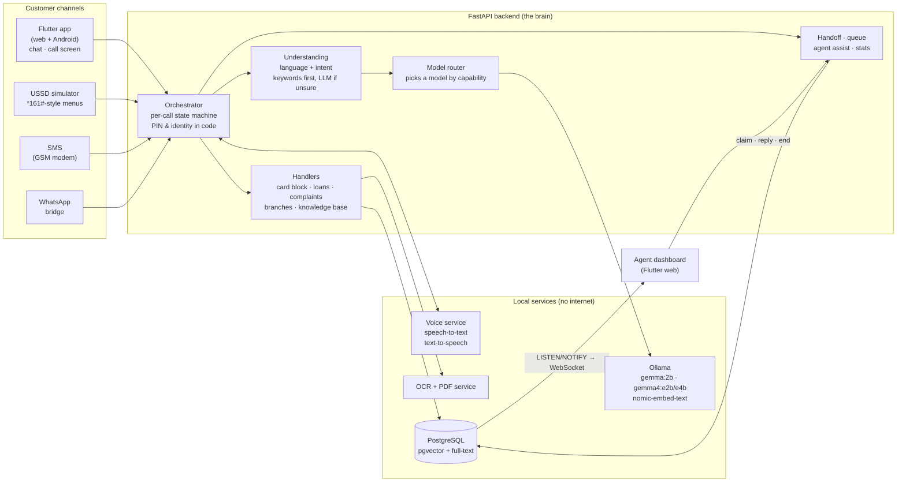

# Kabangutsi

**An AI call-center assistant for BancoBu (Burundi) that answers customers in French, English and Kirundi, by
text and voice, runs 100 % on one laptop with no cloud, and hands the call to a human agent with a summary when
it should.**

Simple requests are answered at once by the AI, so human agents keep their time for the calls that need them.

> **All customers, accounts, cards, branches, products, fees and rates in this repository are fictional.**
> No real BancoBu data is used. Demo PINs exist only for the demo.

---

## 1. The problem and our answer

| The challenge asks for… | Kabangutsi does it with… |
|---|---|
| Information on services and products | Search in a bank knowledge base (hybrid keyword + meaning search), answer built **only** from that text |
| Requirements to open an account | Same knowledge base: documents, steps, for individuals and businesses |
| Report a blocked / lost card | A guided flow: account number → PIN or date of birth (checked **in code**) → which card → confirm → card blocked, reference `BLK-2026-00001` |
| Information about loans | Loan products from the database + a **loan simulator** (monthly payment computed exactly, not by the AI) |
| File a complaint | A ticket `TCK-2026-00001` with category and urgency; the customer can ask its status later |
| Branch hours and contacts | Branch search by town / province / name (typos accepted), "open now?" in Bujumbura time |
| Make agents' work easier | Agent dashboard: live queue, AI summary of each call, suggested answers, statistics |
| Simulation is enough | Web + Android app with chat and a **phone-call screen**, plus a USSD simulator; real SMS / WhatsApp adapters are built too |

---

## 2. What the judges can try (5 minutes)

Open two browser windows on the demo machine:

- **Customer app:** http://localhost:8080
- **Agent dashboard:** http://localhost:8080/agent/
- API documentation (every endpoint, try it live): http://localhost:8000/docs

Then type (or say) in the customer app, in any of the three languages:

| Try this | What you should see |
|---|---|
| `Bonjour` / `Hello` / `Amahoro` | Greeting in the same language, menu of what the assistant can do |
| `Quels sont les horaires de l'agence de Ngozi ?` | Hours of the (fictional) Ngozi branch, whether it is open now, a **tappable phone number** |
| `What do I need to open an account?` | The list of documents, taken word for word from the knowledge base |
| `I lost my card` | Card-block flow. Use the fictional persona: account **40012345678**, PIN **1234**, card ending **4821** → reference `BLK-…` |
| `Je veux un crédit de 5 000 000 FBu sur 24 mois` | Loan simulation: **244 816 FBu / month** (16 %, computed in code) |
| `Ndashaka gutanga ikirego` (I want to file a complaint) | Complaint ticket `TCK-…`, number read back |
| `I want to talk to a human` or an angry message | Call appears **immediately** in the agent dashboard queue with an AI summary; an agent claims it and replies to the customer |
| Send a photo of a document | The app switches automatically to a vision model and tells the user which model answered |

Under each answer the app shows **which model answered and how long it took** (or "no model (rules)" when a
rule answered instantly), so you can see where AI is used and where plain code is used.

---

## 3. Architecture at a glance



### One request, step by step

Example: a customer types *"Quels sont les horaires de l'agence de Ngozi ?"*

1. **Channel → standard message.** Every channel (app, USSD, SMS, WhatsApp) is converted by an adapter into the
   same JSON message (`contracts/message.schema.json`). The rest of the system does not care where it came from.
2. **Voice (only for calls).** If the customer spoke, the voice service turns audio into text (French/English with
   Whisper, Kirundi with Meta's MMS model).
3. **Orchestrator.** Loads the conversation's state (language, current flow, failed PIN attempts…). Anything
   security-related — PIN, identity, card blocking — is decided **here, in code**. A PIN is never sent to an AI model.
4. **Understanding (NLU).** Detects the language (fr / en / rn) and the intent (one of: product info, account
   opening, card block, loan, complaint, branch info, talk to a human, other). Strong keywords decide at once
   (< 1 s); only when they are unsure is the local LLM asked, and its JSON answer is validated strictly.
5. **Handler.** The branch handler searches branches in PostgreSQL (with typo tolerance), checks the hours
   against the current time in Bujumbura, and builds the answer from a template in the customer's language.
6. **Reply.** Text in the customer's language, a short ≤ 160-character version for SMS, and — for calls —
   spoken audio produced sentence by sentence so the customer hears the first sentence quickly.
7. **Events.** Every important change (new ticket, handoff, card blocked, stats) is published through
   PostgreSQL `LISTEN/NOTIFY` and pushed over a WebSocket to the agent dashboard in real time.

### Handing over to a human

The assistant hands the call to an agent when: the customer asks for one; the customer is frustrated
(score ≥ 0.7); it did not understand twice in a row; identity checks failed 3 times; the knowledge base has no
answer; or a document needs human review.

The call enters the queue **at once** with a summary built by code; a few seconds later the AI writes a better
3-sentence summary (account numbers removed) and the dashboard updates. Two agents can never take the same call
(database lock `SELECT … FOR UPDATE SKIP LOCKED`). While an agent talks to the customer, the AI suggests answers
taken from the knowledge base.

---

## 4. How we use AI — and where we deliberately don't

| Task | Who does it | Why |
|---|---|---|
| Understanding the request (intent, language, frustration) | Keywords first, local LLM when unsure | Fast and reliable; small models sometimes guess wrong with high confidence |
| Answers about products, fees, account opening | **Extractive search**: best sentences of the knowledge base, as written | Guarantees no invented bank facts |
| Reading an image or document | Vision model (gemma4:e2b), OCR as backup | Auto-switch when the chosen model cannot see images |
| Handoff summary and agent suggestions | Larger model (gemma4:e4b), time-boxed | Quality matters, the customer does not wait for it |
| PIN, identity, card blocking, loan maths, ticket numbers | **Plain code only** | Security and exact numbers must never depend on an AI guess |
| Speech ↔ text | Whisper (fr/en), MMS (Kirundi), Piper / MMS-TTS voices | All run offline on CPU |

**Model auto-switch.** The user can pick a model in the app. If the request needs something that model cannot do
(e.g. an image sent to a text-only model), the router reads each installed model's capabilities from Ollama at
runtime, switches to the first capable one, logs it, and tells the user in their language.

| Model (all local, via Ollama) | Role |
|---|---|
| `gemma:2b` | Default for chat turns: small and fast on CPU |
| `gemma4:e2b` | Images (and audio) through auto-switch |
| `gemma4:e4b` | Hard tasks: handoff summaries, agent suggestions, document field extraction |
| `nomic-embed-text` | Embeddings for meaning-based search in the knowledge base |

---

## 5. Safety and trust

- **The AI never takes a security decision.** PIN and identity are checked in code (argon2 hashes). After 3
  failures the account is locked for 15 minutes and the call goes to a human.
- **PINs never reach a model and are stored nowhere** (not in the transcript, not in logs). A 4-digit number typed
  outside the card flow is masked and the customer is warned never to send their PIN.
- **No invented facts.** Bank answers come only from the knowledge base; when nothing matches, the assistant says
  it does not know and offers a human agent.
- **Privacy.** Account numbers are removed from AI summaries; the SMS gateway does not log message text.
- **Fully offline.** No cloud API, no CDN: models, fonts and packages are downloaded at build time only. The one
  exception is WhatsApp traffic itself.

---

## 6. Three languages, equal priority

French, English and Kirundi are supported everywhere: language detection (it can change mid-conversation),
every reply template, the app interface, USSD menus, voice in and out, and PDF receipts. Kirundi is the hardest
(few AI resources exist): we use Meta's MMS models for Kirundi speech, and Kirundi keyword lists for understanding.
Kirundi texts still need review by a native speaker.

---

## 7. Repository map

| Folder | What is inside | Team |
|---|---|---|
| `contracts/` | The agreements between all parts: REST API (`openapi.yaml`), message and intent formats, WebSocket events, database schema, voice/OCR/adapter APIs. Frozen early so five people could build in parallel | T0 Lead |
| `backend/` | FastAPI app: orchestrator, NLU, model router, handlers, knowledge-base search, handoff/queue/stats, WebSocket | T1 Backend |
| `frontend/` | Flutter (BLoC): customer app (`lib/main_customer.dart`) and agent dashboard (`lib/main_agent.dart`) | T2 Flutter |
| `voice/` | Speech-to-text and text-to-speech service, phrase cache for instant common replies | T3 Voice (branch `t3-voice`) |
| `backend/channels/`, `sms/`, `whatsapp/`, `ocr/` | USSD / SMS / WhatsApp adapters, GSM-modem gateway, WhatsApp bridge, OCR + PDF service | T4 Channels (branch `t4-channels`) |
| `scripts/` | Start / reset demo, pull models, offline check, contract validation, seed data generator, evaluation | T0 |
| `status/` | Each team's progress report: what is done, how it was verified, what is blocked | everyone |

**How the team worked.** Five parallel work streams (one lead + four builders), each on its own git branch and
folder, joined only through the frozen `contracts/`. Branches are merged into `main` at gates: **G1** (text demo:
backend + app — reached) and **G2** (voice, channels, documents).

---

## 8. Run it yourself

Requirements: Linux with Docker, ~16 GB RAM, ~25 GB disk. No GPU needed.

```bash
cp .env.example .env
docker compose build                 # online, once: builds images, installs packages
scripts/pull_models.sh               # online, once: downloads the models (--from-host reuses a host Ollama)
scripts/start_demo.sh --reset        # from here on everything works offline
scripts/offline_check.sh             # proves: images and models present, no container calls out
```

| Service | URL / port |
|---|---|
| Customer app | http://localhost:8080 |
| Agent dashboard | http://localhost:8080/agent/ |
| Backend API + live docs | http://localhost:8000/docs |
| Voice (internal) | 8001 · OCR (internal) 8002 · SMS gateway 8003 · WhatsApp bridge 8004 |

Optional parts are Docker Compose profiles: `--profile voice`, `--profile ocr`, `--profile whatsapp`,
`--profile hardware` (SMS with a USB GSM modem), or `--profile full`.

Known build issue: `frontend/Dockerfile` points to a Flutter image tag that does not exist yet
(`cirruslabs/flutter:3.44.9`). Until it is fixed, build the web app on the host
(`flutter build web --no-web-resources-cdn -t lib/main_customer.dart` and `-t lib/main_agent.dart --base-href /agent/`)
and serve `build/` with nginx using `frontend/nginx.conf`.

### Tests

```bash
cd backend  && pytest          # ~100 tests: 6 request types × 3 languages, PIN never reaches a model, queue locking…
cd frontend && flutter test    # 124 tests: chat, card block, loans, agent queue, phone links…
python scripts/validate_contracts.py
```

---

## 9. Results so far

Measured on the demo laptop (CPU only, 16 GB RAM) with the real local models:

| Measure | Result |
|---|---|
| Correct intent, 150 test sentences | **fr 98 % · en 100 % · rn 100 %** |
| Correct language detected | 100 % in all three languages |
| Typical answer time (median) | **0.33 s** (rules / extractive search) |
| Slow answers (95th percentile) | ~24 s, when the local LLM must decide |
| Image question, warm model | 13–14 s |
| Loan simulation 5 000 000 FBu / 24 months / 16 % | 244 816 FBu — matches hand calculation |

Honest note: those intent scores were measured after improving keywords using the same sentences, so they
flatter the system; a fresh, unseen test set is the next step.

## 10. Limits and next steps

- Voice (T3) and SMS / WhatsApp / OCR (T4) are built and tested on their branches, and are being merged into `main` (gate G2).
- Kirundi wording needs a native-speaker review.
- Image questions are slow on a CPU laptop with little free memory.
- For a real pilot, the fictional knowledge base would be replaced by documents approved by the bank.

---

Contributor rules: [`CLAUDE.md`](CLAUDE.md). Contract details: [`contracts/README.md`](contracts/README.md).
